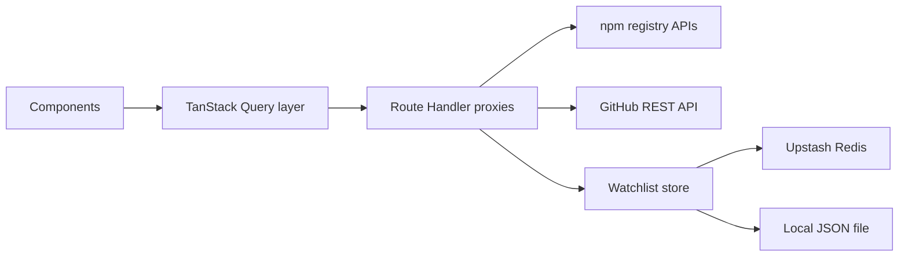

# Registry Radar

Registry Radar is a dashboard I built to watch the health of npm packages and their linked GitHub repositories in one place: weekly downloads, publish history, stars, open issues, and CI status. It runs on Next.js 16 (App Router) with TypeScript and TanStack Query v5, and it is deployed at https://registry-radar.vercel.app.

It defaults to my own packages (@addiplus on npm, addiplus on GitHub) and works for any npm scope or GitHub user.

## Features

- Package grid for any npm scope, each card with a 30 day download sparkline, weekly download total, license, and relative last publish time
- Repo signals per package: stars, open issues + PRs, last push date, and a CI badge filtered to the default branch
- Detail drawer with server paginated version history (Load more) and 7 / 30 / 90 day download charts
- MCP server badges derived from the packument (SDK dependency, mcpName field, or an mcp named bin), plus a CLI badge for plain bins
- Watchlist with pins and 280 character notes, sorted by download momentum (last 7 days minus previous 7)
- Markdown snapshot export of the watchlist, to clipboard or as a .md download
- Light / dark theme via next-themes, system aware
- Honest failure states: GitHub rate limit banner with reset countdown, stale-while-error banners, skeletons, and retry buttons

## Architecture

Four layers, each with one job:



1. **Route Handler proxies** (`src/app/api/`, `src/lib/server/`): the browser never talks to npm or GitHub directly. Route handlers proxy registry.npmjs.org, api.npmjs.org, and api.github.com, which avoids CORS entirely and gives secrets one home (`GITHUB_TOKEN` is read server side only, in `src/lib/server/github.ts`). Upstream responses are cached with `fetch` revalidate, and every error maps to one `ApiErrorBody` contract (`src/lib/api-error.ts`).
2. **Pure transforms** (`src/lib/transforms/`): dependency free functions that map upstream payloads (packuments, download ranges, repo DTOs) into typed view models. No Next.js imports, so they unit test directly.
3. **Query layer** (`src/lib/query/`): TanStack Query hooks, a key factory (`keys.ts`), fetchers that throw typed `ApiError`s, optimistic mutations, and a zero dependency rate limit store.
4. **Store adapter** (`src/lib/store/`): one `WatchlistStore` interface with two implementations. A single factory (`src/lib/store/index.ts`) picks Upstash Redis when the KV env vars are present, else a local JSON file. Client code never branches.

## Why these TanStack Query choices

Everything below is wired in `src/lib/query/hooks.ts`, `src/lib/query/mutations.ts`, `src/app/get-query-client.ts`, and `src/app/page.tsx`.

- **Per resource staleTime as named constants.** All staleness lives in one `STALE_TIME` object in `src/lib/constants.ts`. Downloads get 1 hour because npm download stats update daily (and lag 1 to 2 days), so anything tighter is wasted refetching. Repo signals get 5 minutes because stars and CI actually move, but the unauthenticated GitHub budget is 60 requests per hour. Package and version metadata get 30 minutes because they only change on publish. The watchlist gets 30 seconds because it is a local store that should feel snappy.
- **Dependent queries for repo signals.** A package's GitHub repo is not known until its metadata resolves, so `useRepoSignals` takes the `RepoRef` from `usePackageMeta` and gates on `enabled: !!repoRef` (`src/lib/query/hooks.ts`). No repo mapping, no request fired.
- **Two genuine infinite queries.** Version history is server paginated with offset/limit: `useVersionHistory` follows `nextOffset` until the server returns null (`src/lib/query/hooks.ts`, `src/lib/server/npm.ts`). The GitHub repo list follows the page cursor derived from the `Link: rel="next"` response header (`src/lib/server/github.ts`). Both drive Load more buttons through `hasNextPage` / `fetchNextPage`.
- **Canonical optimistic mutations.** The pin and note mutations in `src/lib/query/mutations.ts` follow the full pattern: `onMutate` cancels in flight watchlist queries, snapshots the previous cache with `getQueryData`, and applies the change with `setQueryData`; `onError` rolls back from the snapshot; `onSettled` invalidates exactly one key, `qk.watchlist()`. Package data queries are never refetched by mutations.
- **Targeted invalidation plus a selective global refresh.** There are exactly three `invalidateQueries` call sites in the app: two watchlist only (the mutations), and the refresh button, which uses a predicate to invalidate every `rr` key except the watchlist (`src/lib/query/hooks.ts`). There is no zero argument `invalidateQueries()` anywhere.
- **Hover prefetch for instant drawers.** Card hover calls `prefetchInfiniteQuery` for version history page 0 under the same query key the drawer consumes (`src/lib/query/hooks.ts`, `src/components/package-card.tsx`), so the drawer opens with data already in cache.
- **SSR hydration of the default grid.** `src/app/page.tsx` is a Server Component that `prefetchQuery`s the default scope listing plus metadata and 30 day downloads for the first 24 packages, then renders `<HydrationBoundary state={dehydrate(queryClient)}>`. `src/app/get-query-client.ts` uses the canonical pattern: a fresh QueryClient per server request, a module level singleton in the browser, held in `useState` by the provider. A default staleTime of 30 minutes means hydrated data does not refetch on mount.

## Running locally

```bash
git clone https://github.com/addiplus/registry-radar.git
cd registry-radar
npm install
npm run dev
```

Open http://localhost:3000.

The app works with zero configuration: the watchlist falls back to a local JSON file (`.data/watchlist.json`). Optional environment variables, documented with placeholders in `.env.local.example`:

- `KV_REST_API_URL` / `KV_REST_API_TOKEN`: Vercel KV (Upstash Redis) for a persistent shared watchlist. `UPSTASH_REDIS_REST_URL` / `UPSTASH_REDIS_REST_TOKEN` also work.
- `GITHUB_TOKEN`: raises the GitHub API budget from 60 to 5000 requests per hour.

## Testing

```bash
npm run test:run
```

45 tests across 11 files, all passing. The suites cover the pure transforms (packument mapping, download series math, repo URL parsing, MCP badge rules, error mapping, Markdown export, relative time) and the TanStack Query hooks with a mocked fetch, including an optimistic rollback test that asserts the cache both mid flight and after rejection. CI runs the same suite on every push to main and on pull requests via GitHub Actions (`.github/workflows/ci.yml`).

## Notes on honesty

- Unauthenticated GitHub API access is 60 requests per hour per IP. The app treats that as a first class state, not a crash: every GitHub response reports its rate limit headers into a small store, a banner counts down to the reset time, stale data stays on screen with a stale-while-error notice, and the refresh button disables while limited.
- npm download stats lag 1 to 2 days, so labels anchor off the API returned end date ("week ending {end}"), never the local clock. The 90 day series is a custom date range (both ends inclusive) because npm has no 90 day preset.
- The demo watchlist is shared across all visitors. On Vercel it is stored ephemerally (serverless /tmp) and the UI says so, unless Upstash KV is configured.

## v2 ideas

- User accounts and per user watchlists
- Historical warehousing of download series (the APIs only serve the trailing window)
- GitHub GraphQL to collapse the per repo REST calls into one query
- Multi package comparison overlays on one chart
- MCP introspection playground for the flagged MCP servers

## License

MIT, see LICENSE.
